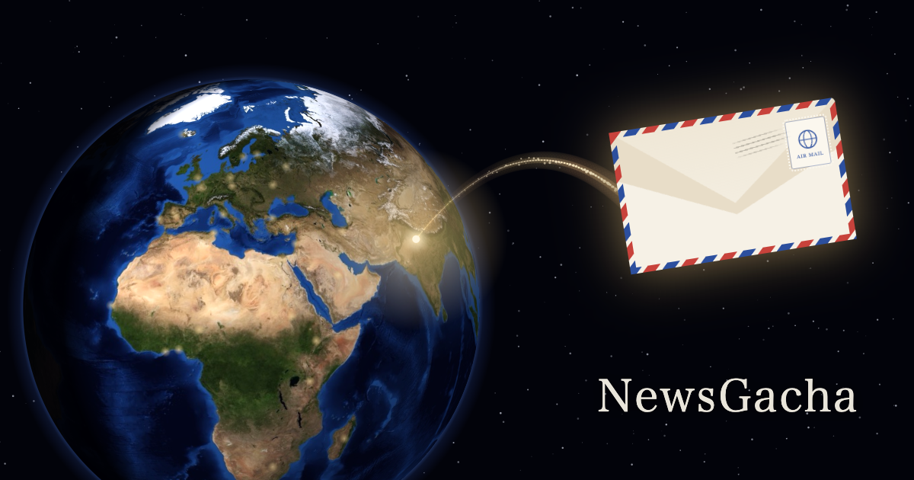
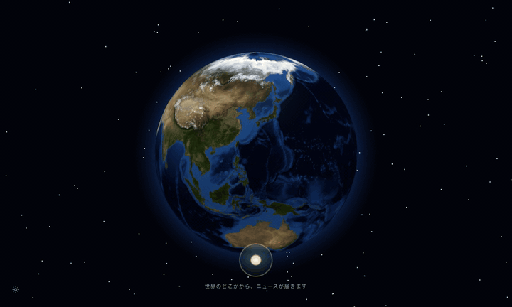
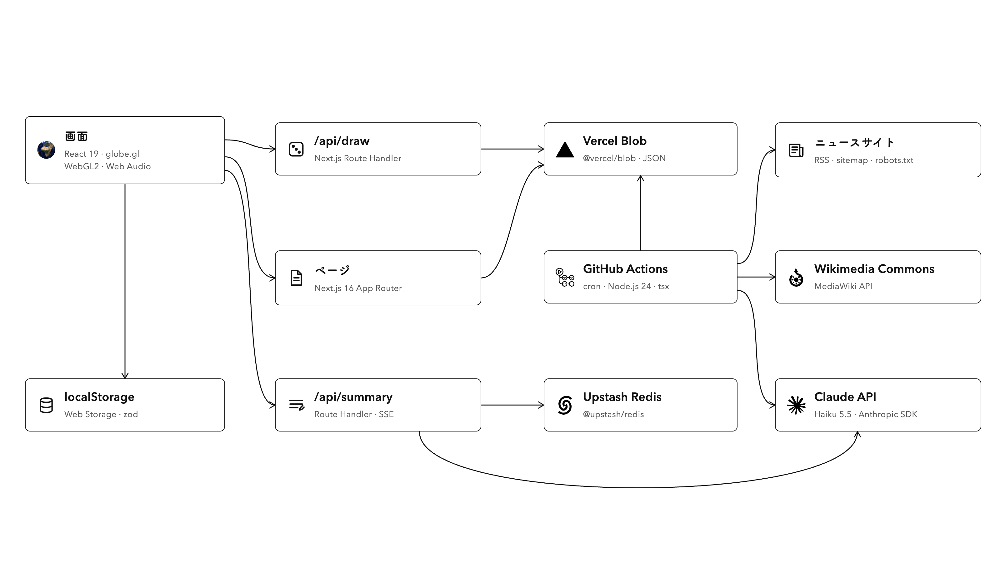

<p align="center">
  
</p>

<h1 align="center">NewsGacha</h1>

<p align="center">
  <b>世界は、小さなニュースでできている。</b><br>
  ボタンを押すと、地球のどこかの町の今日のニュースが、一通の手紙になって届きます。
</p>

<p align="center">
  <a href="https://world-news-gacha.vercel.app"><b>▶ 手紙を受け取る</b></a>
  &nbsp;·&nbsp;
  <a href="https://world-news-gacha.vercel.app/about">NewsGacha について</a>
</p>

---

## なぜ作ったか

私たちは、世界のニュースを知っているつもりでいます。
でも目に入るのは、いつも同じ場所の、大きな見出しです。

見出しは、スポットライトに似ています。照らされた場所だけが、世界のように見えてきます。
本当は、どの町にも今日があります。その町の人のために書かれた、小さな見出しがあります。

NewsGacha は、その小さな見出しを、くじで一通ずつ届けます。
あなたの好みに合わせて選ぶのではなく、**偶然に任せて**。

## 一通が届くまで

<p align="center">
  
</p>

1. **ボタンを押す。** 地球が回りはじめます。
2. **地球が止まった町から、封筒が飛んでくる。** タップすると開きます。
3. **手紙を読む。** 見出しは元の言葉のまま。そこに、あなたの言葉の短い要約がそえられています。続きは元の新聞のサイトで。

読んだ町には灯りが残り、地球が少しずつ、あなたが手紙を受け取った場所で埋まっていきます。
地球を長押しすると、その場所の近くから引くこともできます。

## くじに使うのは、これだけ

| 使うもの | 使わないもの |
|---|---|
| **偶然**：国のくじ。どの国も同じ確率 | **あなたの好み**：好きそうな国や、ジャンル |
| **その国の、今日の新聞**：その町の人のための見出し | **みんなが読んでいるもの**：人気の記事、ランキング |
| **さっきまで届いた手紙**：同じ一通が続かないように | **あなたの読み方**：読んでいた時間、クリックした数 |
| **あなたが自分で決めたこと**：地図に立てたピン | **あなたについての推測**：年齢や、住んでいる場所 |

だから次の一通は、あなたにも、私たちにも分かりません。

## 約束していること

- **読んだ手紙は、あなたのブラウザの中にだけ。** 何を読んだかを、私たちは保存しません。アカウントもありません。
- **新聞社のルールを守る。** 各サイトの robots.txt に従い、有料の記事や有料の新聞は使いません。記事の本文も使いません。読むときは、必ず元のサイトへ移動します。
- **要約は AI が書いています。** 間違えることがあるので、手紙の下にいつもそう書いています。

## 仕組み

<p align="center">
  
</p>

### 収集：1日1回、40か国・109紙から

GitHub Actions（`cron: 17 10 * * *`）が `npm run collect` を実行し、8紙ずつ並行して約5分で集めます。1紙ごとの処理は [`scripts/lib/pipeline.ts`](web/scripts/lib/pipeline.ts) の `processOutlet()` です。

1. **robots.txt**（フィード側）を確認してから、RSS かサイトマップを読む
2. 媒体ごとのルール（会員限定の印やライブブログの URL を除く、見出しの末尾の媒体名を外す など）で整える
3. **robots.txt**（記事側）をもう一度確認。すべてのクローラー、または要約に使う AI の会社のクローラーを断っているサイトは使わない
4. **有料記事を除く**：RSS で分かる印に加え、記事ページの schema.org `isAccessibleForFree: false` を見る
5. **Claude Haiku 5.5 の構造化出力で採点**：記事の町（8言語の地名と座標）、その国の中の話題か、遠くの読み手にとっての面白さ
6. **座標の検算**：AI の座標が国の範囲外なら、媒体の拠点に置く
7. **写真の確認**：ロゴや使い回しの画像を除き、実際にアクセスして確かめる。なければ Wikimedia Commons の自由ライセンスの写真

結果（約2,400本/日）は非公開の **Vercel Blob** に `articles.json` として置きます。他人の見出しを配ることになるので、公開リポジトリには入れません。

### くじ：`/api/draw`

ルールは純粋な関数として [`lib/draw.ts`](web/src/lib/draw.ts) にあり、[テスト](web/src/lib/draw.test.ts)があります。

| 段階 | 選び方 | ねらい |
|---|---|---|
| ① 国 | 40か国から**均等**に。直近に出た国は (国の数−1)÷3 か国ぶん避ける | 記事の多い国ばかりにしない |
| ② 新聞 | **√(記事数)** で重みづけ | 大きな新聞が少し有利、でも独占しない |
| ③ 見出し | AI の面白さの**2乗**で重みづけ。直近12本は除く | 遠くの読み手に届く見出しを選びやすく |

- ピン（読み手が立てた場所）があれば、5回に1回は `?near=lat,lng` でその近くから引きます。500km → 1000km → 2000km → 4000km と広げて探し、②③は同じ選び方です。
- 判定はブラウザで行い、サーバーに届くのは丸めた座標と、直近の記事 ID だけです。
- `articles.json` は各サーバーのメモリに置き、10分ごとに ETag で更新を確認します（変わっていなければ 304 で、読み直さない）。

### 要約：`/api/summary`（SSE）

- 見出しと、記事に添えられた短い説明文だけから、Claude Haiku 5.5 が読み手の言語（8言語）で1〜3文の要約を書きます。本文は使いません。
- Server-Sent Events で書いたそばから流し、画面はタイプライターのように一定の速さで打ちます。
- **Upstash Redis** に `summary:<記事ID>:<言語>` で4日間キャッシュ。AI や Redis が落ちていても、新聞の説明文で手紙は届きます。

### 画面：演出が、そのまま待ち時間になる

- ボタンを押した瞬間に、くじ・要約のストリーム・写真の先読みを**同時に**始めます。地球が回る3.6秒（＋着地のズーム0.75秒）のあいだに、裏で手紙が書き上がっていきます。
- 地球は **globe.gl**（three.js）。回転は標準のアニメーションを使わず、5乗の ease-out で自前で描き、着地点を画面座標に直して、封筒をそこから飛ばしています。
- about ページの地球は、**WebGL2 のフラグメントシェーダー1つ**で球を描いています（三角形1枚、正射影、経度180°の継ぎ目を `textureGrad` で解消）。同じ部品を、読むページの背景と共有画像にも使っています。
- 音は **Web Audio API**。回転の風、着地の音、鐘はその場で合成し、紙の音は CC0 の録音。最後にリミッターを入れています。
- 受け取った手紙と設定は `localStorage` にだけ保存します。

## 技術

| | |
|---|---|
| 画面 | Next.js 16（App Router・Cache Components）、React 19、TypeScript |
| 地球 | globe.gl（three.js）。about ページは WebGL2 のシェーダーで描いた地球 |
| 音 | Web Audio API（着地と鐘の音は、その場で合成） |
| AI | Claude API（Haiku 5.5。見出しの場所と面白さの判定、8言語の要約） |
| 保存・配信 | Vercel、Vercel Blob、Upstash Redis（要約のキャッシュ） |
| 収集 | GitHub Actions で毎日1回 |
| テスト | Vitest |

<details>
<summary><b>手元で動かす</b></summary>

```bash
cd web
npm install
npm run dev        # http://localhost:3000
npm run collect    # ニュースを集める（web/data/ に保存）
npm test
```

`web/.env.local` に `ANTHROPIC_API_KEY=` を入れると、AI による判定と要約が使えます。キーがなくても動きます（そのときは要約の代わりに、新聞の説明文がそのまま出ます）。

</details>

## クレジット

- 地球の画像：NASA Blue Marble（パブリックドメイン。three-globe の配布物から）
- 国旗：[flag-icons](https://github.com/lipis/flag-icons)（MIT）
- 構成図のロゴ：[Simple Icons](https://simpleicons.org)（CC0）。ロゴの権利は、それぞれの会社にあります
- 紙の音：Freesound の CC0 の録音（[一覧](web/public/sounds/CREDITS.md)）
- 見出しと写真の権利は、それぞれの新聞社にあります。掲載について：[掲載メディアの方へ](https://world-news-gacha.vercel.app/publishers)
